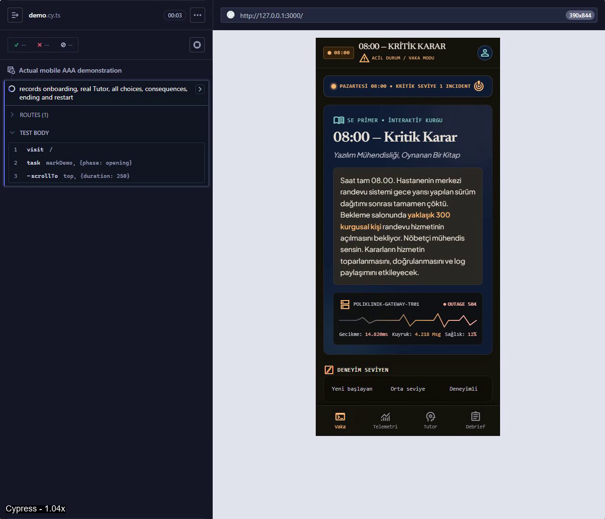
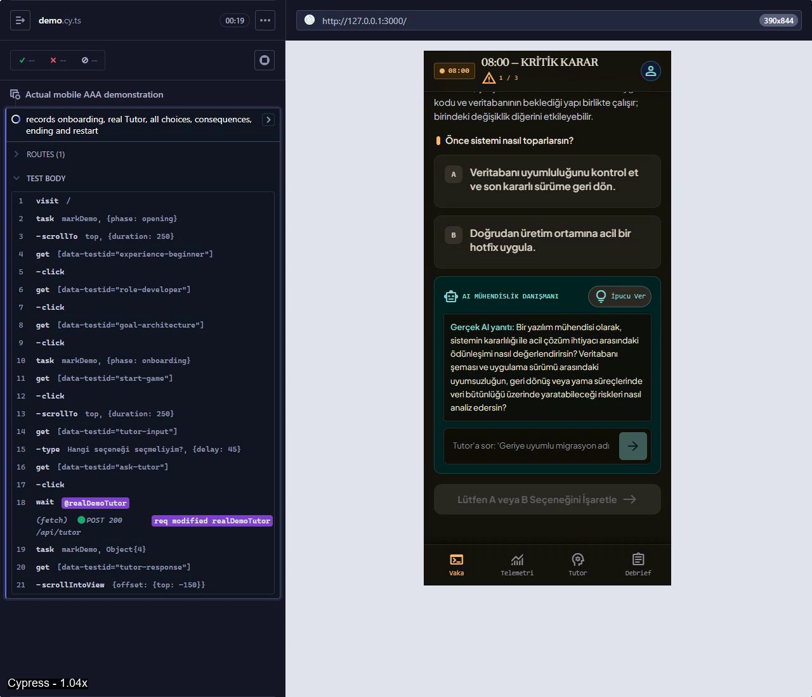

> Güncel inceleme kaydı: Emre, AI yardımıyla hazırlanan yorumları onayladı ve CSV’de 20/20 inceleme alanı dolduruldu; 18 geçti, 2 kaldı (S04, S09). Bu, ayrıca yapılmış bağımsız değerlendirici incelemesi olarak sunulmaz. Güncel kayıt: [human-review.csv](eval/human-review.csv) ve [review-provenance.json](eval/review-provenance.json). Aşağıdaki pending ifadeleri ilk değerlendirme koşusunun tarihsel durumudur.

# 08:00 — Kritik Karar

**YZM301 — Yazılım Gerçekleme ve Test**  
**SE Primer: Yazılım Mühendisliği, Oynanan Bir Kitap**

Pazartesi 08:00'de gece sürümü sonrası duran kurgusal hastane randevu sistemini toparla. Nöbetçi yazılım mühendisi olarak mimari, test ve log gizliliği üzerine üç karar ver; teknik nedenleri ve sonuçlarını gör. Yaklaşık 300 kurgusal kişi hizmetin açılmasını bekliyor. Gerçek hasta verisi veya tıbbi teşhis kullanılmaz.

Bu depo Google Stitch / Google AI Studio Build dışa aktarımının devamıdır. Özgün arayüz korunmuş, teslimi engelleyen tutarlılık ve test sorunları düzeltilmiştir.

[Son doğrulama raporu](docs/FINAL-REPORT.md) · [Specification](spec.md) · [Tasarım](DESIGN.md) · [Test sonuçları](docs/test-results.md) · [Tutor değerlendirmesi](docs/tutor-evaluation.md) · [58 saniyelik demo](demo/se-primer-demo.mp4)

## Gerçek çalışma görüntüleri

Gerçek Cypress demosundan alınan kareler; AI ile üretilmiş uygulama görüntüsü değildir:




Üç özgün tasarım ekranı ve HTML dışa aktarımları [DESIGN.md](DESIGN.md) içindedir.

## Özellikler ve mimari

- Tam üç onboarding seçimi: deneyim, rol, öğrenme hedefi; 27 profil ortak hikâye grafiğini kullanır.
- Üç sıralı A/B kararı; kesinleştirme sonrası kilitlenen seçim ve ayrı neden-sonuç açıklaması.
- Dört deterministik son ve tüm seçimlerin korunduğu final özeti.
- Gerçek sunucu tarafı Gemini Socratic Tutor; hata halinde etiketli yerel ipucuyla devam.
- Temiz yeniden başlatma; eski AI yanıtını iptal etme; oturum bellektedir, yenilemede sıfırlanır.
- Mobil düzen, görünür klavye odağı, süre sınırı olmadan simüle edilen baskı ve yerel ikon fontları.

React + TypeScript + Vite arayüzü → aynı origin üzerinde Express `/api/tutor` → mevcut `@google/genai` SDK'sı → `gemini-3.1-flash-lite`. API anahtarı yalnızca sunucudadır. Hikâye içeriğinin ortak kaynağı [story/decision-tree.json](story/decision-tree.json); sonu [src/decisionEngine.ts](src/decisionEngine.ts) hesaplar. Gemini seçim veya sonucu değiştiremez. [Durum makinesi](docs/state-machine.md).

| Yol (Mimari / Test / Gizlilik) | Son |
|---|---|
| AAA | ENDING_SAFE |
| AAB | ENDING_PRIVACY_INCIDENT |
| ABA | ENDING_RECURRING_OUTAGE |
| ABB | ENDING_PRIVACY_INCIDENT |
| BAA | ENDING_FRAGILE |
| BAB | ENDING_PRIVACY_INCIDENT |
| BBA | ENDING_RECURRING_OUTAGE |
| BBB | ENDING_PRIVACY_INCIDENT |

Öncelik: gizlilik olayı → tekrar kesinti → kırılgan kurtarma → güvenli kurtarma. Gizlilik sonucu gösterilirken önceki kesinti veya hotfix ihtiyacı özetten silinmez. Hukuki ihlal veya yaptırım otomatik ilan edilmez.

## Yerel kurulum

Node.js **22.16+** ve npm kullanıldı; `package-lock.json` depodadır. Çalışma dizini deponun kökü olmalıdır.

```sh
npm ci
```

`.env.example` dosyasını `.env.local` olarak kopyalayıp yalnızca yerel dosyada `GEMINI_API_KEY` değerini doldurun. Windows PowerShell: `Copy-Item .env.example .env.local`. Mevcut `.env.local` dosyasını yeniden kopyalayarak ezmeyin. Anahtarı Git'e veya VITE_ değişkenine koymayın. Örnek dosyadaki değerler boştur.

Varsayılanlar: `PORT=3000`, `GEMINI_MODEL=gemini-3.1-flash-lite`. Sunucu `.env.local`, sonra `.env` okur; önceden enjekte edilmiş değişkenler önceliklidir.

```sh
npm run dev
```

Adres: `http://127.0.0.1:3000`. Sağlık kontrolü: `/api/health`. API anahtarı olmadan da hikâye oynanır; Tutor yerel ipucu gösterir.

Üretim çıktısını yerel çalıştırma:

```sh
npm run build
npm run start:prod
```

`start:prod` NODE_ENV değerini yalnızca kendi sürecinde ayarlar. `npm start` AI Studio'nun mevcut başlatması olarak korunur. `npm run preview` yalnızca Vite statik önizlemesidir; Tutor sunucusu için Express gerekir.

## Doğrulama komutları

```sh
npm run typecheck
npm test
npm run build
npm run security:scan
npm run test:server
```

`npm test`: sekiz son, geçersiz seçim, altı etki ve 27 profil için 11 birim testi. `test:server`: üretim sunumu, input doğrulama ve gerçek anahtar-yok fallback'i için beş kontrol. İlk ihraç sürümünde mevcut test yoktu.

Cypress için sunucu çalışıyorsa:

```sh
npm run cy:run
```

Sunucu çalışmıyorsa otomatik başlat/durdur:

```sh
npm run test:e2e
```

Sekiz yol + 11 özellik testi, 390×844 mobil görünüm ve ayrıca 360 px taşma kontrolü. Bu testlerde Tutor ağ yanıtları kontrollüdür; Gemini kalitesi kanıtı sayılmaz. Ayrı gerçek entegrasyon:

```sh
npm run test:live
```

Bu komut gerçek API anahtarı ve çalışan sunucu gerektirir. Tarayıcı hataları bastırılmaz; başarısız testler ekran görüntüsü ve video bırakır. Çıktılar `artifacts/cypress/`; teslimdeki seçilmiş raporlar `evidence/` altındadır. `ELECTRON_RUN_AS_NODE` yalnızca Cypress alt sürecinde kaldırılır; işletim sistemi ayarı değişmez.

Sunucu çalışırken bağımlılık, typecheck, build, unit, üretim sunucusu, deterministik Cypress ve gizli bilgi kontrollerini topluca yürütme:

```sh
npm run verify
```

## Gerçek Tutor Eval

Anahtarı tutan terminalde normal sunucu yerine kanıt kaydı açık sunucuyu çalıştırın:

```sh
npm run dev:evidence
```

Başka terminalde:

```sh
npm run tutor:smoke
npm run tutor:eval
npm run tutor:report
```

Bu komutlar gerçek Gemini istekleri yapar; quota kullanır. Billing veya ücretli servis açmaz. İstekler sıralıdır, geçici hatalarda en fazla bir yeniden deneme vardır. Yeniden koşmadan önce mevcut `eval/` sonuçlarının tarihli kopyasını koruyun. Ham model çıktıları `eval/raw/`; ana rapor `eval/tutor-results.json`, insan kontrol tablosu `eval/human-review.csv`.

Veri kümesi, yazarın hazırladığı tam 20 öğrenci-mesajı test vakasıdır. **20 gerçek Gemini yanıtı alınmıştır; gerçek öğrenci katılımcı sayısı 0'dır.** Ön değerlendirme: 18/20 geçiş; 0/20 doğrudan cevap sızıntısı; 20/20 düşünme sorusu; 2/20 teknik doğruluk notu. Bağımsız insan incelemesi **pending (0/20)**. Rapor üretimi insan onayı yerine geçmez.

## Gerçek Cypress demosu

Çalışan sunucu ve yerel Gemini anahtarıyla:

```sh
npm run demo:record
npm run demo:edit
npm run demo:verify
```

Veya tek komut: `npm run demo:all`. FFmpeg/FFprobe yerel npm geliştirme bağımlılıklarıdır; sistem geneline kurulum yapılmaz. Demo AAA yolunu, bir gerçek AI yanıtını, üç kararı/etkiyi, sonu ve yeniden başlatmayı gösterir. API yoksa gerçek hata durumu kayda girer; sahte yanıt eklenmez.

Son video: [demo/se-primer-demo.mp4](demo/se-primer-demo.mp4), **58.000 saniye**, 1280×1100. [Ham kayıt](demo/raw/cypress-1792839278807.mp4), [düzenleme manifesti](demo/edit-manifest.json), [FFprobe/doğrulama](demo/video-verification.json). Gerçek oynatma katsayısı videoda `1.04x` olarak belirtilmiştir; tüm ham kayıt korunur.

## Tasarım ve AI Studio ilişkisi

Özgün üç Stitch tasarım PNG'si, üç HTML çıktısı ve notlar `public/assets/aistudio/` içinde değiştirilmeden korunur. İlk tasarım istemi [STITCH_BRIEF.md](docs/STITCH_BRIEF.md), güncel tasarım sözleşmesi [DESIGN.md](DESIGN.md). Stitch proje URL'si dışa aktarımda yoktur.

Mevcut dışa aktarımda bulunan [AI Studio uygulama bağlantısı](https://ai.studio/apps/075bc6dc-af43-479d-9c55-a4e8382a2d60) bu oturumda yeniden açılarak doğrulanmadı. Yerel değişiklikler AI Studio mimarisiyle uyumlu tutuldu; buluta sync veya deployment yapılmış olduğu iddia edilmez. [Yerel / AI Studio / üretim farkları](docs/ai-studio-compatibility.md).

## Sonuçlar ve açık sınırlamalar

Yerel typecheck/build, 11/11 birim testi, 8/8 yol + 11/11 özellik testi, 1/1 canlı tarayıcı entegrasyonu, 1/1 demo koşusu ve 58 sn MP4 doğrulaması tamamlandı. Tam kanıt ve önceki başarısız koşular [test-results.md](docs/test-results.md) içinde.

İnsan Tutor incelemesi bekliyor; S04/S09 teknik doğruluk notları korunuyor. Gerçek öğrenci örneklemi toplanmadı. AI Studio'nun güncel bulut sürümü ve Stitch proje bağlantısı doğrulanmadı. Tam WCAG denetimi yapılmadı; harici metin fontları yüklenemezse sistem yedek fontları kullanılır. Oturum yenilenince ilerleme sıfırlanır.

Tam üç bilinçli dışlama:

1. **Kullanıcı hesapları:** Tek oturumluk deneyim kimlik yönetimi gerektirmez.
2. **İkinci bölüm:** İlk bölümün test ve teslimine odaklanılır.
3. **Gerçek hasta verisi:** Gereksiz gizlilik ve güvenlik riskleri önlenir.

Gerekçeler: [product-decisions.md](docs/product-decisions.md).

## Teslim bağlantıları

- [GitHub deposu](https://github.com/Miku-erm/karr)
- [Son rapor](docs/FINAL-REPORT.md)
- [58 sn demo](demo/se-primer-demo.mp4)
- [20-vaka değerlendirme ve insan inceleme CSV'si](docs/tutor-evaluation.md)
- [Çalışan yerel uygulama](http://127.0.0.1:3000)
- [Dışa aktarımda verilen AI Studio URL'si](https://ai.studio/apps/075bc6dc-af43-479d-9c55-a4e8382a2d60) — bu çalışmada sync/deploy doğrulanmadı.
