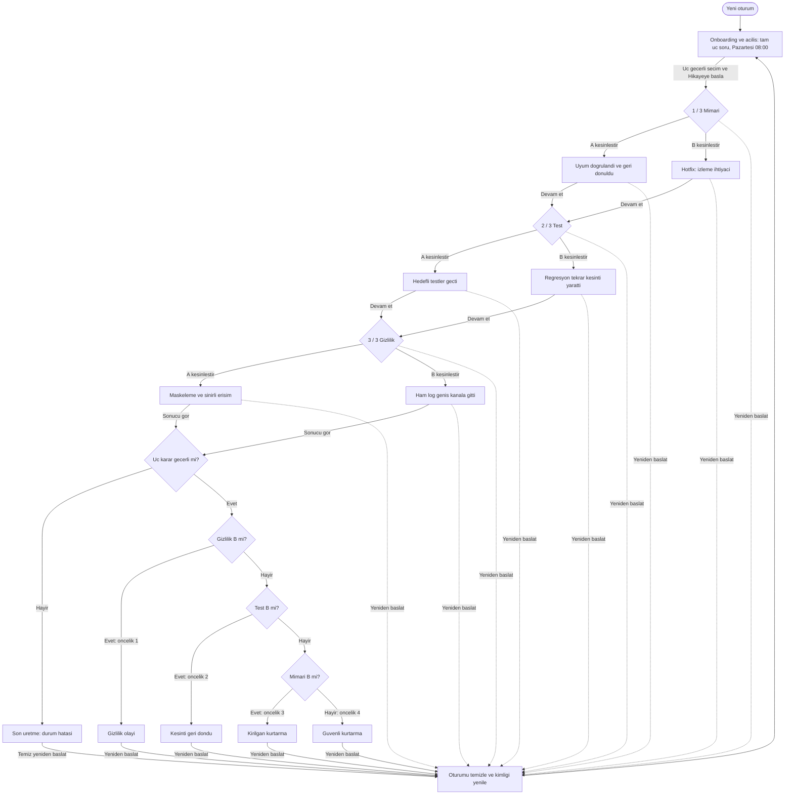
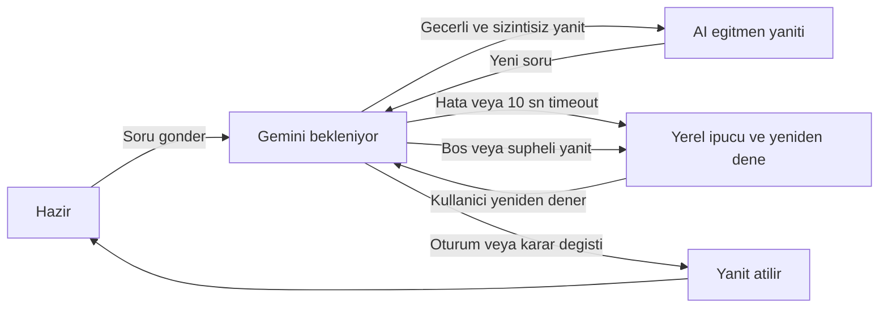

# Durum makinesi — 08:00 — Kritik Karar

Bu grafik uygulama planıdır. Profil yalnızca sunumu değiştirir; her oyuncu üç karar ve üç geri bildirim görür. A/B seçeneğini işaretlemek taslaktır, kesinleştirmek olaydır. Kesinleşmiş geçmiş değiştirilemez.

## Ana akış

Grafik etiketleri ayrıştırıcı uyumluluğu için sade Latin harfleriyle yazıldı; gerçek UI metinleri `STITCH_BRIEF.md` içindeki Türkçe biçimlerdir. `ENDING_*` düğüm kimlikleri JSON son kimlikleriyle aynıdır.

## Geçiş ve koruma kuralları

| Durum / olay | Koruma | Yazılan veri ve hedef |
|---|---|---|
| ONBOARDING / seçim | Her gruptan tek izinli değer | Yalnızca profil taslağı; otomatik hikâye başlangıcı yok |
| ONBOARDING / başla | Üç alan da geçerli | Açılış aynı ekrandadır; profil sabitlenir → architecture, pendingChoice=null |
| D1, D2, D3 / A veya B işaretle | Mevcut karar kesinleşmemiş | pendingChoice güncellenir; AI veya sonuç çağrısı gerekmez |
| Karar / kesinleştir | pendingChoice A/B; önceki tüm kararlar kesinleşmiş | Seçim bir kez kaydedilir → o seçimin C durumu |
| C1A/C1B / devam | 1. sonuç gösterilmiş | testing ekranı, pendingChoice=null |
| C2A/C2B / devam | 2. sonuç gösterilmiş | privacy ekranı, pendingChoice=null |
| C3A/C3B / sonucu gör | Üç karar tamam | Seçimleri doğrula → öncelikli deterministik değerlendirme |
| Sonuç / görüntüle | Tek endingId hesaplanmış | Üç ayrı seçim/etki satırı + sonuç metni + hedef vurgusu |
| Aktif karar, geri bildirim, sonuç / yeniden başlat | Kullanıcı tıklaması | Tüm oturumu temizle → ONBOARDING |
| Her durum / sayfa yenile | Bellek oturumu | Aynı temiz başlangıç; kalıcı kayıt yüklenmez |

Eksik/geçersiz seçim, geliştirici veya veri hatasıdır; sessizce A ile doldurulmaz ve Gemini'den son istenmez. Görünür metin: “Oturum bilgisi doğrulanamadı. Yeniden başlatarak devam edebilirsin.” Tarayıcı geri düğmesi kesinleşmiş kararı yeniden düzenlenebilir yapmaz; ekran durumu oturumun geçerli durumundan türetilir. Geçmişi değiştirmek için temiz yeniden başlatma gerekir.

## Tutor bağımsız alt akışı

Ana akış Tutor durumunu beklemez. İstek sürerken seçim kesinleştirilirse `before_choice` isteği artık geçersizdir; yeni evre için bağlam yeniden oluşturulur. Sonuç ekranında açık cevap üretimi yerine deterministik özet kullanılır. Yeniden başlatma istekleri iptal eder ve oturum kimliğini değiştirir; önceki cevabın yeni öğrenci profiline sızması engellenir.

## Sekiz yolun izleri

| Yol | Karar sonrası durumlar | Son |
|---|---|---|
| AAA | C1A → C2A → C3A | ENDING_SAFE |
| AAB | C1A → C2A → C3B | ENDING_PRIVACY_INCIDENT |
| ABA | C1A → C2B → C3A | ENDING_RECURRING_OUTAGE |
| ABB | C1A → C2B → C3B | ENDING_PRIVACY_INCIDENT |
| BAA | C1B → C2A → C3A | ENDING_FRAGILE |
| BAB | C1B → C2A → C3B | ENDING_PRIVACY_INCIDENT |
| BBA | C1B → C2B → C3A | ENDING_RECURRING_OUTAGE |
| BBB | C1B → C2B → C3B | ENDING_PRIVACY_INCIDENT |

Tüm izler her sonuçtan `RESET → ONBOARDING` geçişiyle tekrar oynanabilir. Özette C1, C2 ve C3 etkilerinin tamamı korunur. Kişiselleştirme bu düğümlere yeni dal eklemez.
